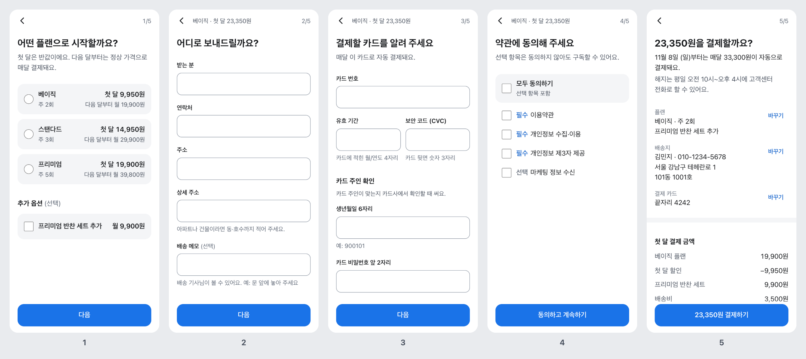

# toss-inspired-ux

토스가 공개한 디자인 원칙에서 영감을 받아 만든, AI 코딩 에이전트용 UI/UX 가이드예요.
Claude Code나 Codex에 설치해 두면, 화면을 만들거나 리뷰할 때 에이전트가 이 원칙을 따라요.

> **비공식 프로젝트예요.** 토스(비바리퍼블리카)와 관련이 없고, 토스의 로고·폰트·아이콘·컴포넌트를 포함하지 않아요. 토스가 공개한 글과 가이드를 읽고 원칙을 직접 다시 정리했어요. 출처는 [SOURCES.md](SOURCES.md)에 있어요.

[English](#english)

## 무엇이 달라지나요

에이전트에게 "회원가입 화면 만들어 줘"라고 하면 보통 입력 칸 여러 개와 버튼이 한 화면에 나열돼요. 이 Skill을 설치하면 에이전트가 화면을 그리기 전에 먼저 흐름을 설계해요.

- **한 화면에 한 가지 일.** 화면마다 목적 하나, 주요 버튼 하나.
- **가치 먼저, 비용은 나중에.** 입력이나 권한을 요청하기 전에 무엇을 얻는지 보여 줘요.
- **3초 안에 답할 수 있는 질문.** 시스템이 알 수 있는 건 묻지 않고, 추천과 기본값을 줘요.
- **끊기지 않는 화면 전환.** 이전에 입력한 내용이 계속 보이고, 뒤로 가기는 항상 뒤로 가고, 빈 화면이나 갑작스러운 팝업이 없어요.
- **이유 있는 모션.** 정지 화면으로 충분하면 넣지 않고, 넣을 땐 방향·시간·감속 규칙을 지켜요.
- **말하듯 쓴 문구.** 한국어는 해요체, 능동형, 긍정형으로 쓰고, 버튼은 누르면 일어나는 일을 말해요.
- **길을 알려 주는 에러 메시지.** 무슨 일인지, 왜 그런지, 지금 할 수 있는 일.
- **다크패턴 없음.** 진입을 막는 팝업, 뒤로 가기 가로채기, 거절할 수 없는 화면을 만들지 않아요.
- **접근성 기본.** 큰 글씨, 스크린 리더, 동작 줄이기 설정에서도 쓸 수 있게 만들어요.

### 예시: 결제 화면 리뷰하고 고치기

문제를 일부러 심어 둔 테스트용 결제 화면을 주고 "UX 리뷰하고 고쳐 줘"라고 요청한 결과예요.

| 원본 (테스트용으로 만든 화면) | Skill을 적용해 고친 화면 |
|---|---|
|  |  |

진입 팝업, 가짜 타이머, 미리 체크된 옵션과 동의, 뒤로 가기 가로채기를 없애고, 한 화면에 몰려 있던 입력을 다섯 단계로 나눴어요. 마지막 화면은 오늘 낼 금액과 다음 달부터 낼 금액, 해지 방법을 결제 전에 보여 줘요.

## 설치

### Claude Code

터미널에서:

```bash
claude plugin marketplace add JaceProgramming/toss-inspired-ux
```

```bash
claude plugin install toss-inspired-ux@toss-inspired-ux
```

Claude Code 세션 안에서는 `/plugin marketplace add JaceProgramming/toss-inspired-ux` 다음에 `/plugin install toss-inspired-ux@toss-inspired-ux`를 입력해요.

### Codex

```bash
codex plugin marketplace add JaceProgramming/toss-inspired-ux
```

```bash
codex plugin add toss-inspired-ux@toss-inspired-ux
```

### 직접 복사

플러그인 없이 Skill 폴더만 써도 돼요. 이 저장소의 `skills/toss-inspired-ux` 폴더를 아래 위치에 복사해요.

| 에이전트 | 내 모든 프로젝트 | 한 프로젝트만 |
|---|---|---|
| Claude Code | `~/.claude/skills/` | `<프로젝트>/.claude/skills/` |
| Codex | `~/.agents/skills/` | `<프로젝트>/.agents/skills/` |

Agent Skills 형식(`SKILL.md`)을 읽는 다른 에이전트에서도 같은 폴더를 그대로 쓸 수 있어요.

## 사용법

UI 작업을 요청하면 에이전트가 알아서 불러와요. "토스"라는 말을 하지 않아도 돼요.

```
회원가입 플로우 만들어 줘. 이름, 휴대폰 번호, 약관 동의를 받아야 해.
```

```
이 결제 화면 UX 리뷰해 줘.
```

```
결제 실패했을 때 보여 줄 에러 메시지 써 줘. 카드 한도 초과, 네트워크 오류, 점검 중.
```

직접 부르고 싶으면 Claude Code에서는 `/toss-inspired-ux:toss-inspired-ux`, Codex에서는 `$toss-inspired-ux`를 입력해요.

이미 디자인 시스템이 있는 프로젝트라면 그 컴포넌트와 색상은 그대로 두고, 화면 구조·흐름·문구·동작에만 이 원칙을 적용해요.

## 들어 있는 것

```
skills/toss-inspired-ux/
├── SKILL.md                     핵심 규칙과 작업 순서 (에이전트가 항상 읽는 부분)
├── assets/
│   └── flow-shell.html          단계형 흐름의 동작 예제 (뒤로 가기, 전환, 로딩 버튼, 토스트)
└── references/                  필요할 때만 읽는 세부 문서
    ├── principles.md            제품 원칙 10가지와 적용 방법
    ├── screen-patterns.md       질문 화면, 폼, 동의, 확인, 결과, 목록 등 화면 패턴
    ├── flow-continuity.md       화면 전환의 연속성, 모션 규칙, 로딩 처리
    ├── motion-recipes.md        웹·React Native·SwiftUI·Compose·Flutter 구현 코드
    ├── ux-writing.md            문구 원칙, 에러 메시지, 알림 문구
    ├── ux-writing-ko.md         한국어 문구 규칙 (해요체, 능동형, 긍정형, 표기)
    ├── visual-defaults.md       디자인 시스템이 없을 때 쓰는 기본 토큰
    ├── accessibility.md         접근성과 시니어 사용자 고려 사항
    ├── dark-patterns.md         다크패턴 목록과 대안
    └── review-checklist.md      기존 화면을 리뷰하는 기준과 보고 형식
```

에이전트용 문서는 영어로, 한국어 문구 규칙은 한국어로 썼어요.

## 검증한 것

- **설치.** Claude Code 2.1.293과 Codex CLI 0.160.1에서 마켓플레이스 추가, 플러그인 설치, Skill 인식을 확인했어요.
- **코드 예제.** 참고 문서의 웹 예제와 `flow-shell.html`을 헤드리스 Chrome 155에서 실행해 확인했어요(화면 전환, 뒤로 가기, 바텀시트, 토스트, 동작 줄이기, 다크 모드). React Native, SwiftUI, Compose, Flutter 예제는 실행해 보지 못했어요.
- **효과.** 같은 과제를 Skill을 적용한 에이전트와 적용하지 않은 에이전트에게 한 번씩 맡기고, 미리 정한 기준으로 채점했어요.

| 과제 | 모델 | Skill 적용 | 미적용 |
|---|---|---|---|
| 회원가입 플로우 만들기 | Claude Opus 5.5 | 13/13 | 13/13 |
| 결제 화면 리뷰하고 고치기 | Claude Opus 5.5 | 18/18 | 17/18 |
| 에러 메시지 쓰기 | Claude Opus 5.5 | 8/8 | 8/8 |
| 회원가입 플로우 만들기 | Claude Haiku 4.5 | 10/13 | 5/13 |

읽을 때 주의할 점이에요.

- **큰 모델은 Skill 없이도 잘해요.** Opus는 미적용 버전도 기준을 거의 다 통과했어요. 차이는 점수가 아니라 구조에서 났어요. 위 결제 화면 예시처럼 긴 폼을 단계로 나누고, 리뷰를 "어디, 원칙, 사용자가 겪는 일, 고치는 방법"과 문구 전후 표로 정리한 쪽이 Skill 적용 버전이에요.
- **작은 모델에서 차이가 커요.** Haiku 미적용 버전은 휴대폰 인증 단계에서 막혀 가입을 끝낼 수 없었어요. 다만 Skill을 적용해도 작은 모델은 구현 버그를 냈어요. 테스트 뒤 Skill을 고쳐 다시 돌린 실행(11/13)에서는 뒤로 가기와 약관 표기는 고쳐졌지만, 약관 화면에서 스크립트 오류로 진행이 막혔어요. 결과물은 직접 실행해서 확인하세요.
- **토큰이 더 들어요.** 세 과제에서 5%, 54%, 60% 더 썼어요. 참고 문서를 읽는 비용이에요. 테스트 뒤 과제별로 읽을 문서를 좁히도록 고쳤지만, 고친 뒤의 비용을 Opus로 다시 재지는 않았어요.
- **과제당 한 번씩만 실행했어요.** 편차는 알 수 없으니 방향을 보는 정도로만 읽어 주세요.
- **Codex에서는 설치만 확인했어요.** 결과물 품질은 Claude 모델로만 비교했어요.

## 알아 둘 점

- **토스의 공식 디자인 시스템이 아니에요.** 토스가 공개한 글에서 원칙을 읽고 직접 다시 쓴 가이드예요. 토스의 문장, 그래픽, 컴포넌트를 옮겨 오지 않았어요.
- **토스처럼 보이게 만드는 도구가 아니에요.** 토스의 색상, 폰트, 아이콘은 들어 있지 않아요. 만드는 제품의 브랜드를 그대로 쓰고, 토스의 사고방식만 가져와요.
- **모션 시간, 간격, 색상 같은 수치는 토스의 스펙이 아니에요.** 토스는 모션에 대한 생각을 공개했지만 수치는 공개하지 않았어요. 이 가이드의 수치는 플랫폼에서 널리 쓰는 기본값이에요.
- **앱인토스 미니앱을 만든다면** 토스의 [공식 가이드](https://developers-apps-in-toss.toss.im/)가 우선이에요.
- 코드 품질과 접근성 구현은 토스가 직접 공개한 [frontend-fundamentals](https://github.com/toss/frontend-fundamentals) 플러그인과 함께 쓰면 좋아요.

## 라이선스

[MIT](LICENSE). 이 저장소의 글과 코드에 적용돼요. "토스"와 "Toss"는 비바리퍼블리카의 상표이고, 이 저장소는 그 이름을 출처를 밝히는 용도로만 써요.

---

## English

An agent skill that brings the design thinking Toss (the Korean fintech) has shared publicly into Claude Code, Codex and other agents that read `SKILL.md`: one thing per screen, value before cost, questions answerable in three seconds, continuous screen-to-screen flow, purposeful motion, plain friendly copy, humane error messages, and no dark patterns.

**Unofficial.** Not affiliated with Toss or Viva Republica. It contains no Toss assets and restates published ideas in its own words. See [SOURCES.md](SOURCES.md). Numeric defaults (motion timing, spacing, colours) are common platform conventions, not Toss specifications.

```bash
claude plugin marketplace add JaceProgramming/toss-inspired-ux
```

```bash
claude plugin install toss-inspired-ux@toss-inspired-ux
```

```bash
codex plugin marketplace add JaceProgramming/toss-inspired-ux
```

```bash
codex plugin add toss-inspired-ux@toss-inspired-ux
```

Or copy `skills/toss-inspired-ux` into `~/.claude/skills/` (Claude Code) or `~/.agents/skills/` (Codex).

The skill is written in English. Korean copywriting rules live in a Korean reference file and apply only when the product's interface is in Korean.
